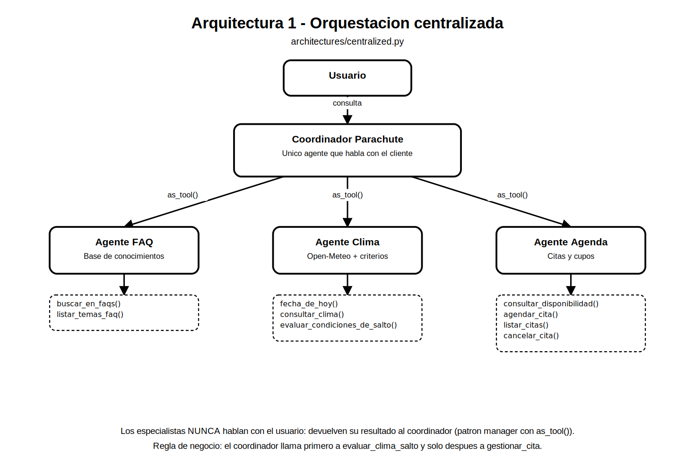
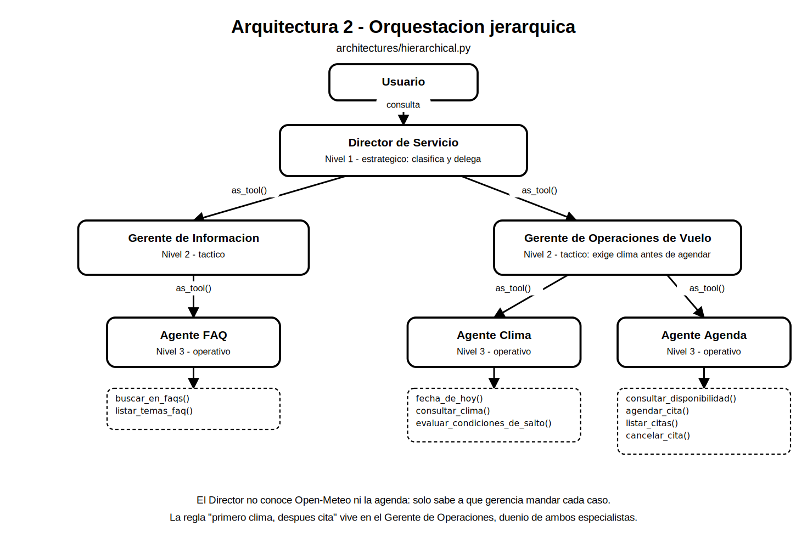
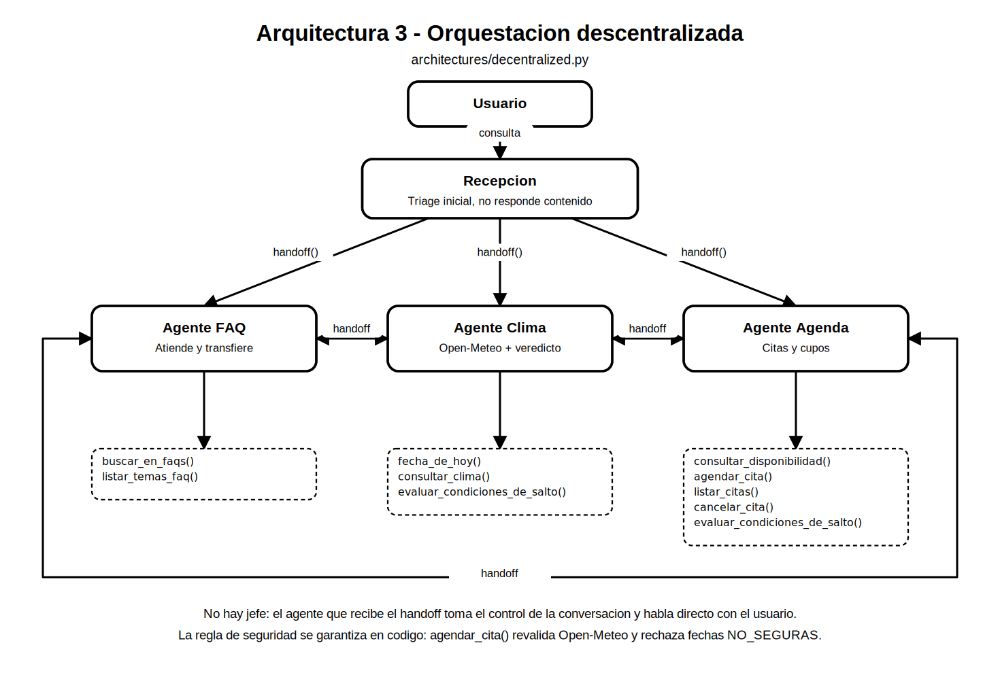

# Hoja de trabajo #5 - Orquestacion de sistemas multiagentes

**Caso:** Parachute S.A. - FAQs + calendarizacion de citas con verificacion de clima

**Repositorio:** https://github.com/quiqueb06/HDT-5-AI-

**Entregable:** tres programas que resuelven el mismo problema con arquitecturas de orquestacion distintas, sus diagramas y este documento de respuestas.

## 1. Que se construyo

Se implemento un asistente para Parachute S.A. que cubre tres requerimientos funcionales:

- Responder preguntas frecuentes desde una base de conocimientos (precios, requisitos, logistica, politicas).
- Consultar el clima de la zona de aterrizaje (14.013722, -90.771611) en la API gratuita de Open-Meteo, usando el bloque `current` para hoy y `daily` para fechas futuras, y obteniendo rafaga de viento (`wind_gusts_10m`), temperatura (`temperature_2m`), precipitacion (`precipitation`), cobertura de nubes (`cloud_cover`) y viento en superficie (`wind_speed_10m`).
- Calendarizar citas unicamente si el clima de esa fecha cumple los criterios de seguridad, corrigiendo al usuario cuando pide una fecha a mas de 16 dias (limite de pronostico de Open-Meteo).

El mismo problema se resolvio tres veces, cambiando solo la orquestacion:

| Programa | Arquitectura | Mecanismo del SDK |
|---|---|---|
| `architectures/centralized.py` | Centralizada | `as_tool()` sobre 3 especialistas |
| `architectures/hierarchical.py` | Jerarquica (3 niveles) | `as_tool()` encadenado: director -> gerentes -> especialistas |
| `architectures/decentralized.py` | Descentralizada | `handoffs` bidireccionales entre pares |

### 1.1 La abstraccion que permite las tres implementaciones

Parachute S.A. advirtio que seguira agregando requerimientos, asi que la logica de integracion se aislo en el paquete `core/`, que no sabe nada de agentes:

- `core/weather.py`: cliente de Open-Meteo (validacion de la ventana de 16 dias, `current` vs `daily`, cache y modo simulado).
- `core/rules.py`: motor de reglas puro que aplica los umbrales y devuelve un veredicto `IDEAL` / `MARGINAL` / `NO_SEGURO`.
- `core/faq.py`: base de conocimientos en JSON con recuperacion por relevancia.
- `core/scheduling.py`: agenda con cupos por horario y persistencia.
- `core/tools.py`: las mismas nueve `function_tool` para las tres arquitecturas.
- `core/specialists.py`: fabricas de los agentes FAQ, Clima y Agenda.

Los tres programas solo difieren en el cableado de agentes: ninguno reimplementa la integracion ni las reglas. Agregar un requerimiento nuevo significa agregar una herramienta en `core/tools.py` y colgarla del especialista correspondiente; las tres arquitecturas la heredan sin cambios.

### 1.2 Criterios de seguridad implementados

| Variable | Ideal | Marginal | No seguro |
|---|---|---|---|
| Viento en superficie (`wind_speed_10m`) | < 20 km/h | 20 - 28 km/h (tandem experimentado) | > 28 km/h |
| Rafagas (`wind_gusts_10m`) | <= 35 km/h | - | > 35 km/h |
| Precipitacion (`precipitation`) | 0.0 mm | - | > 0.0 mm |
| Cobertura de nubes (`cloud_cover`) | < 30% | 30 - 75% | > 75% |
| Temperatura (`temperature_2m`) | informativa | informativa | no bloquea |

El veredicto global es el peor de los criterios. Si Open-Meteo no devuelve alguna de las cuatro variables criticas, el sistema responde `SIN_DATO` y tampoco autoriza el salto (falla del lado seguro).

## 2. Las tres arquitecturas

### 2.1 Centralizada



Un unico agente, el *Coordinador Parachute*, conversa con el cliente y usa a los tres especialistas como herramientas (`as_tool()`). Los especialistas nunca hablan con el usuario: devuelven su resultado al coordinador, que redacta una sola respuesta. La regla "primero clima, despues cita" vive en el prompt del coordinador.

### 2.2 Jerarquica



Tres niveles. El *Director de Servicio* (nivel 1) solo clasifica y delega en dos gerencias (nivel 2): *Informacion al Cliente* y *Operaciones de Vuelo*. Cada gerencia coordina a sus especialistas (nivel 3). La regla critica ya no vive en el nodo raiz sino en el Gerente de Operaciones, que es duenio tanto del Agente Clima como del Agente Agenda y puede imponer el orden entre ellos.

### 2.3 Descentralizada



No hay jefe. *Recepcion* hace el triage inicial y transfiere el control con `handoff()`; a partir de ahi el agente que recibe la conversacion habla directamente con el cliente y decide por si mismo si la transfiere a otro par. Los handoffs entre los tres especialistas son bidireccionales.

Como ningun nodo puede garantizar una regla global, la restriccion de seguridad se movio al codigo: la herramienta `agendar_cita()` vuelve a consultar Open-Meteo y rechaza cualquier fecha con veredicto `NO_SEGURO`, sin importar que agente la invoque.

## 3. Respuestas a las preguntas

### Pregunta 1: Que arquitectura o arquitecturas resuelven mejor este problema? Por que?

**Respuesta corta:** las dos arquitecturas con supervisor (centralizada y jerarquica) resuelven mejor este problema. Para el alcance actual la **centralizada** es la mas eficiente, y la **jerarquica** es la que mejor aguanta el crecimiento que Parachute S.A. ya anuncio. La descentralizada es la menos adecuada como arquitectura principal.

**Por que.**

1. **El problema tiene una restriccion de orden que es critica para la seguridad.** Nunca se puede confirmar una cita sin haber evaluado el clima primero. Esa clase de regla global necesita un punto donde se imponga. En la centralizada la impone el coordinador, y en la jerarquica la impone el Gerente de Operaciones, que es duenio de los dos agentes involucrados. En la descentralizada no existe ese punto: cada agente decide por su cuenta si transfiere o no, y la unica forma confiable de garantizar la regla fue sacarla del LLM y ponerla en codigo, dentro de `agendar_cita()`. Eso funciona, pero significa que la arquitectura no esta aportando el control, sino que hay que compensarla.

2. **Las tareas son dependientes, no independientes.** El flujo real es una cadena: interpretar la fecha, consultar Open-Meteo, aplicar los criterios, revisar cupos y confirmar. El patron manager (`as_tool()`) esta hecho para eso: el supervisor mantiene el estado de la tarea y encadena llamadas. Los handoffs estan pensados para el caso contrario, cuando una conversacion cambia de dominio y ya no vuelve (soporte que deriva a cobranza). Aqui casi toda cita cruza dos dominios, asi que la version descentralizada termina haciendo transferencias de ida y vuelta entre Clima y Agenda.

3. **Las consultas reales son mixtas.** "Cuanto cuesta y me agendas el sabado?" toca FAQ, clima y agenda al mismo tiempo. Un supervisor llama a los tres especialistas y entrega **una** respuesta coherente. En la descentralizada el cliente termina hablando con el agente que quedo activo, la respuesta llega partida en varios turnos y el tono de marca es mas dificil de mantener.

4. **Trazabilidad y auditoria.** Para una empresa donde una mala decision implica riesgo fisico, importa poder reconstruir quien autorizo que. Con supervisor hay un solo hilo de ejecucion y un solo responsable del turno; con handoffs el control esta disperso y la traza es mas dificil de seguir.

5. **Entre centralizada y jerarquica, el criterio es el crecimiento.** Hoy, con tres dominios y nueve herramientas, la centralizada gana: un nivel menos de anidamiento significa menos latencia y menos tokens, y el prompt del coordinador todavia es manejable. Pero Parachute S.A. ya aviso que vendran mas requerimientos (pagos, transporte, cursos AFF, video). Cada requerimiento nuevo en la centralizada agrega una herramienta y mas reglas al mismo prompt, y la precision para elegir herramienta se degrada cuando el catalogo crece. En la jerarquica el especialista nuevo se cuelga de la gerencia que corresponda: el prompt del director no cambia y cada nivel sigue viendo pocas opciones. Por eso la jerarquica es la arquitectura objetivo.

6. **Donde si serviria la descentralizada.** Si el dia de maniana cada dominio fuera realmente autonomo y con conversaciones largas dentro de un mismo tema (por ejemplo un agente de cobranza que atiende todo un caso de principio a fin), los handoffs evitarian el cuello de botella del supervisor y reducirian saltos. Tambien es la opcion natural si distintas areas de la empresa quisieran operar sus agentes de forma independiente. No es el caso de este problema.

**Resumen comparativo:**

| Criterio | Centralizada | Jerarquica | Descentralizada |
|---|---|---|---|
| Control de la regla "clima antes de cita" | Alto (un prompt) | Alto (en la gerencia duenia del dominio) | Bajo: hay que garantizarla en codigo |
| Latencia y costo por consulta | Mejor | Media (un salto extra) | Variable: baja si no hay transferencias, alta si rebota |
| Respuesta unica y coherente | Si | Si | No: responde el agente activo |
| Escalabilidad a mas requerimientos | Se degrada (prompt y catalogo crecen) | Mejor: se agrega bajo una gerencia | Buena en agentes, dificil en reglas globales |
| Trazabilidad | Alta | Alta | Media |
| Riesgo principal | Cuello de botella y prompt saturado | Mas saltos, mas tokens | Reglas globales no garantizadas |

### Pregunta 2: Considera que es necesario utilizar un sistema multiagente en este caso? Por que?

**Respuesta corta:** para el alcance actual, no es estrictamente necesario. El problema se resuelve bien con **un solo agente y un buen conjunto de herramientas**. El sistema multiagente se justifica como preparacion para el crecimiento que la empresa ya anuncio, no por el requerimiento de hoy.

**Por que no es necesario hoy.**

- La parte dificil del problema no es de razonamiento sino determinista. Quien decide si se puede saltar no es el LLM: es `core/rules.py`, que compara numeros contra umbrales. Y quien impide agendar un dia inseguro es `agendar_cita()`, que revalida el clima. Ningun agente extra mejora esa decision.
- Solo hay tres dominios y nueve herramientas con nombres claros y poco ambiguos. Un unico agente con esas nueve herramientas elige correctamente sin necesidad de delegar, y evita los costos del multiagente: cada nivel de delegacion es una llamada adicional al modelo, mas latencia, mas tokens y un punto mas donde se puede perder contexto (por ejemplo, que el supervisor no le pase la fecha exacta al especialista).
- No hay concurrencia real que aprovechar: el flujo es secuencial porque la cita depende del clima.

**Cuando si se vuelve necesario.**

- **Cuando crece el catalogo de herramientas.** Parachute S.A. ya dijo que seguira agregando requerimientos. Cuando un solo agente pasa de aproximadamente diez o quince herramientas, la seleccion empieza a fallar y el prompt se vuelve inmanejable. Dividir en especialistas con prompts cortos recupera precision; ese es el argumento mas fuerte a favor del MAS aqui.
- **Cuando hay politicas distintas por dominio.** El Agente FAQ solo lee; el Agente Agenda escribe en sistemas de la empresa y maneja datos personales del cliente. Separarlos permite aplicar guardrails, permisos y auditoria distintos a cada uno, algo que no se puede hacer con granularidad dentro de un solo agente.
- **Cuando conviene mezclar modelos.** Responder FAQs puede correr en un modelo barato y las decisiones de operaciones en uno mas capaz. Con un solo agente se paga el modelo mas caro para todo.
- **Cuando distintos equipos mantienen distintos dominios.** Separar agentes permite que el area de operaciones cambie sus reglas sin tocar el prompt de atencion al cliente, y hace que las pruebas sean por especialista.

**Lo que el multiagente no resuelve.** No mejora la calidad del dato de Open-Meteo, no hace mas correctas las reglas de seguridad y no sustituye validaciones en codigo. De hecho, la leccion mas clara de las tres implementaciones es que las reglas criticas deben vivir en las herramientas y no en los prompts: fue lo unico que hizo que la version descentralizada fuera igual de segura que las otras dos.

**Conclusion.** Para este entregable, el MAS se justifica por la escalabilidad anunciada por el cliente y por la separacion de responsabilidades. En un escenario productivo real, lo razonable seria arrancar con un agente y sus herramientas, e introducir la jerarquia en cuanto el catalogo supere la decena de herramientas o aparezcan politicas distintas por dominio. El diseno de este repositorio permite exactamente eso: como toda la logica vive en `core/`, cambiar de una arquitectura a otra no obliga a reescribir ninguna integracion.

## 4. Como ejecutar

```bash
pip install -r requirements.txt
export OPENAI_API_KEY="sk-..."

python -m architectures.centralized --demo
python -m architectures.hierarchical --demo
python -m architectures.decentralized --demo

python -m core.selftest        # verifica la logica de negocio sin usar LLM
pytest -q                      # 24 pruebas de reglas, fechas, FAQs y agenda
```
